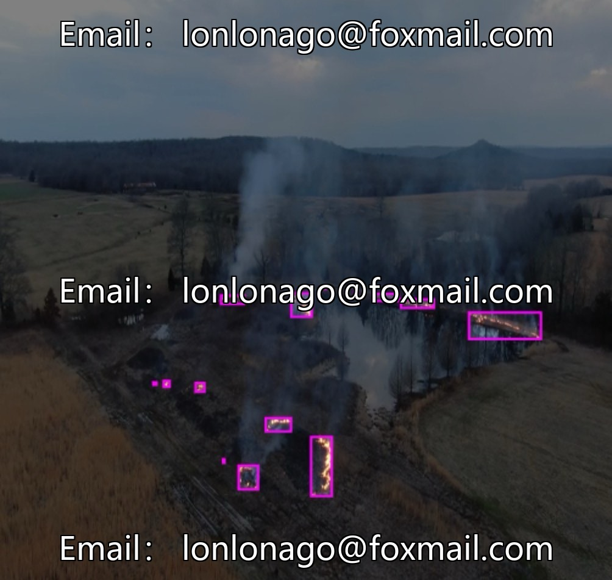
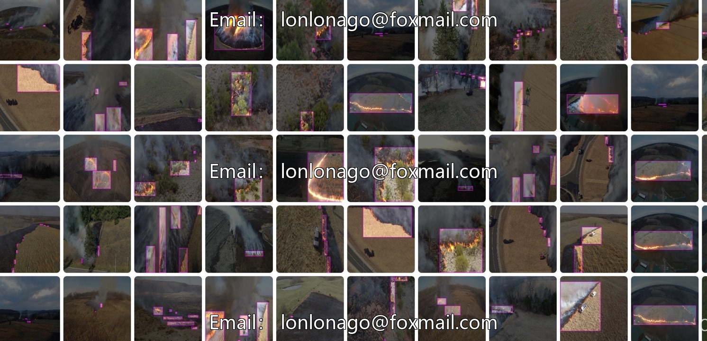
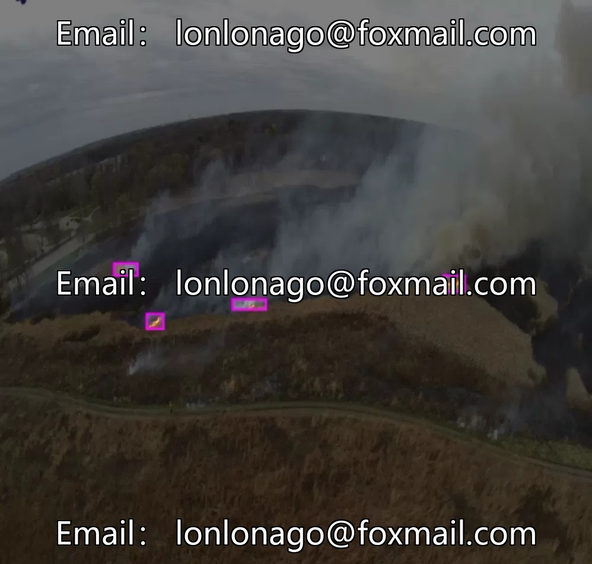
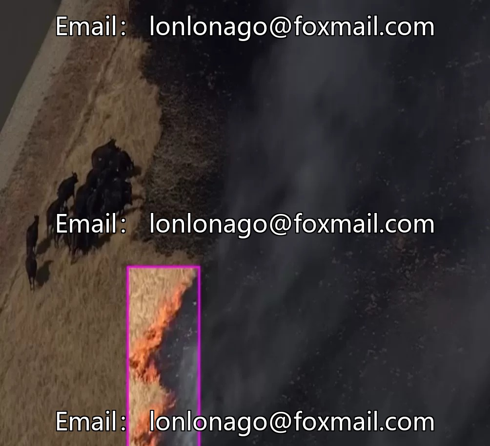

# Drone Forest Flight Inspection Data Set, focusing on forest fire detection, containing 4500 images.

## Body

UAV Forest Flight Inspection Data Set, focusing on forest fire detection, containing 4500 images. Supports two datasets, along with a ready-to-use wildfire detection model. The data format supports the training of mainstream computer vision models, suitable for target detection tasks. The categories are single but highly targeted, capable of accurately recognizing visual features related to fire.

Sufficient data volume, ready-made models, suitable for rapid deployment in forest fire detection, early warning, and forest fire alarm applications. Virtual materials are non-refundable once sold.

Interested friends, click "I want".

## Images

## Payment

Here is a pay link on Stripe ( https://buy.stripe.com/3cs8yP7sY87d0vu9AB ). Please contact me lonlonago@foxmail.com after funding $89, and I will send you a complete data files , thank you!

